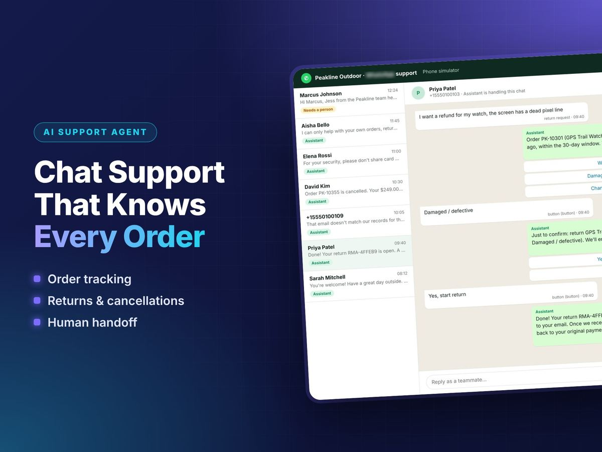
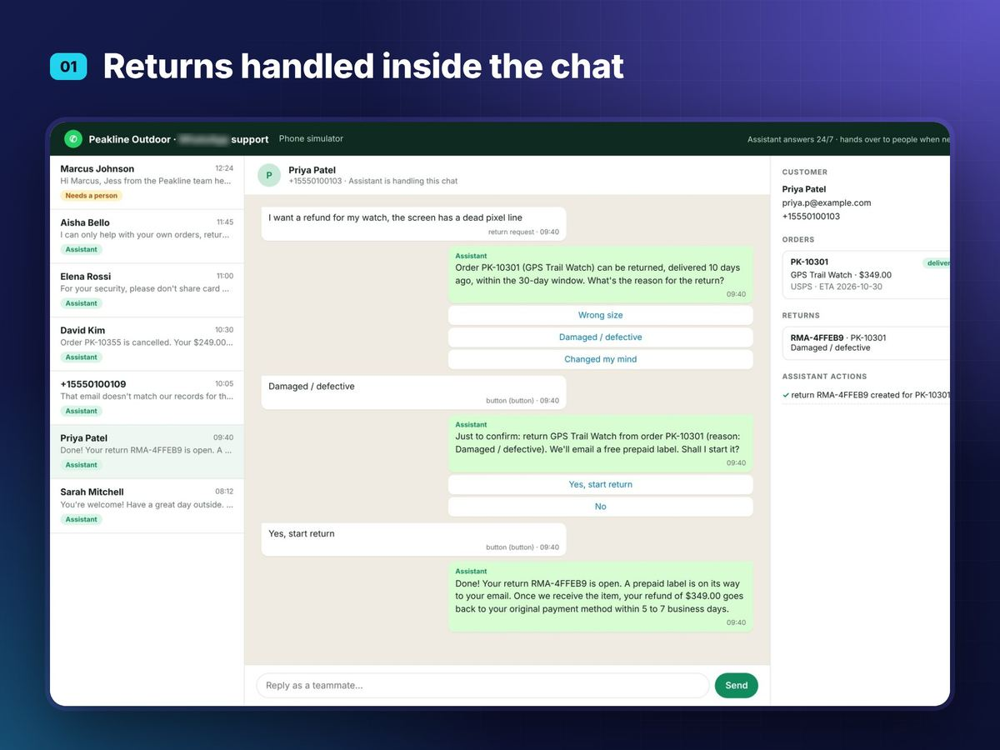
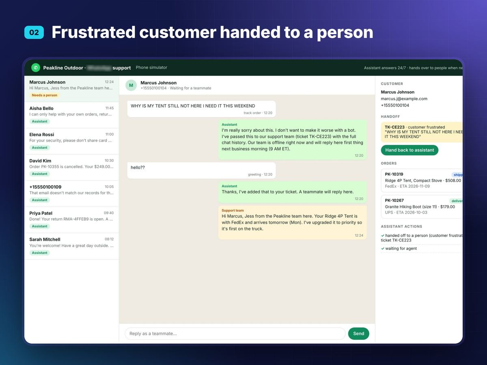
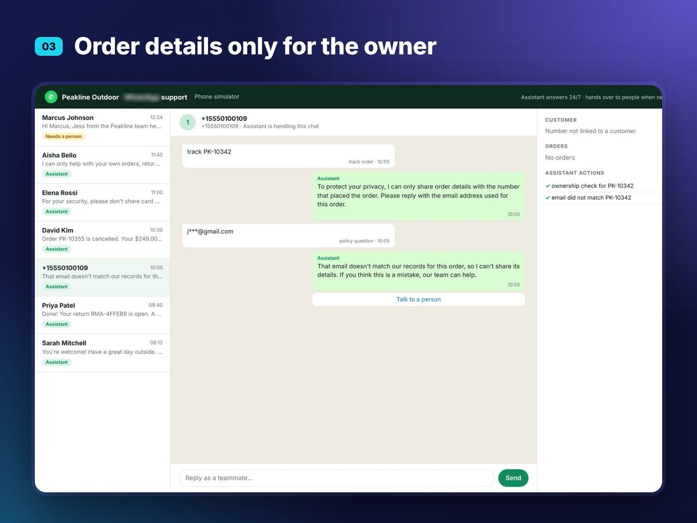
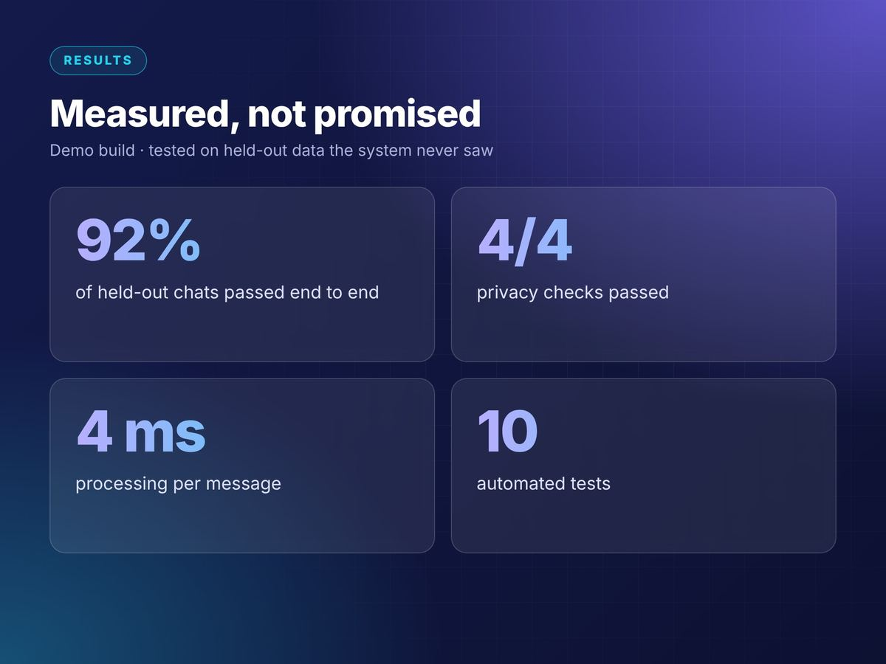

# WhatsApp AI Customer Support Agent

<p align="center"></p>

> Part of **[Afnan Asjad's AI portfolio](https://afnan309.github.io)** · [Hire me on Upwork](https://www.upwork.com/freelancers/~012b76801e57487390)

A WhatsApp Cloud API webhook that answers customers of an online store: order tracking, returns, cancellations,
policy questions and human handoff, with privacy checks on every order lookup.

## Features
- **Tracking**: status, carrier, tracking link, ETA; picks the right order or offers buttons
- **Returns**: 30-day window check, reason buttons, confirmation, return number, refund timing
- **Cancellations**: only before shipping, with a confirm step
- **Policy answers**: retrieval over `data/kb/*.md` (shipping, returns, warranty, sizing, payments, hours)
- **Human handoff**: on request or frustration; ticket with history, bot pauses, team replies from the console,
  "Hand back to assistant" resumes the bot
- **Privacy & safety**: order details only for the number that placed the order (or with the order email),
  prompt-injection block, card numbers detected and masked in logs, webhook signature verification
- Sessions persisted in SQLite (survive restarts)

## Run
```bash
pip install -r requirements.txt
python scripts/seed_demo.py               # demo conversations through the real webhook
SIM_NOW=2026-11-08T12:30 python web/app.py   # console at http://localhost:8500, simulator at /simulator
pytest tests -q                           # 10 tests
python eval/run_eval.py test              # held-out conversations
```

## Connect a real WhatsApp number (Meta Cloud API)
1. Create a Meta app with the WhatsApp product, and note the phone number id and an access token.
2. Deploy `web/app.py` on HTTPS and set:
   `WA_VERIFY_TOKEN`, `WA_APP_SECRET`, `WA_TOKEN`, `WA_PHONE_NUMBER_ID`.
3. In the app dashboard, set the webhook URL to `https://YOUR-DOMAIN/webhook` with your verify token and subscribe to `messages`.
Without `WA_TOKEN` replies are written to `data/outbox.jsonl` (dry run). Payloads follow the Cloud API format
(text and interactive reply buttons); check the Graph API version in `wa_agent/whatsapp.py` against Meta's current docs.

## Results
| Set | Result |
|---|---|
| Dev conversations (16, used while building) | 16/16 |
| Held-out conversations (25, run once) | **23/25 (92%)** · privacy 4/4 · safety 2/2 |

The 2 held-out misses ("how much is shipping?" got the wrong policy sentence; an ALL-CAPS complaint wasn't escalated)
were fixed after that run; 92% is the score before the fixes. All data (customers, orders) is fictional sample data.

## Screenshots

| | |
|---|---|
|  |  |
|  |  |
